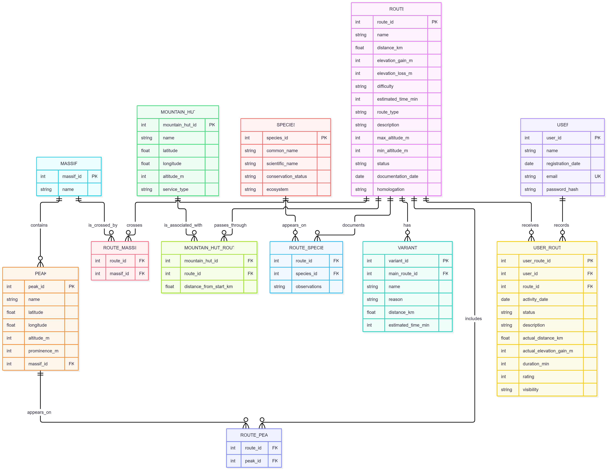

# Hiking and Mountain Routes

A relational SQLite database for cataloguing mountain hiking routes while tracking users' hiking activity.

Final project for [Harvard's CS50 Introduction to Databases with SQL](https://cs50.harvard.edu/sql/).

**Video demo:** [CS50 SQL Final Project, by Gerard Caminal](https://youtu.be/PzaR5GoQKQg)

---

## Overview

The database organises information about hiking routes and their mountain environment, and lets users record the hikes they complete. It stores routes, their variants, peaks, mountain massifs, mountain huts, wildlife and plant species, and registered users, modelling the relationships between all of them with foreign keys and junction tables.

It supports queries to explore routes, find the mountain huts along a route, discover the species documented on a route, list the peaks above a given altitude, and track each user's hiking history while respecting their privacy settings.

The design applies `CHECK`, `NOT NULL`, `UNIQUE` and `FOREIGN KEY` constraints to protect data integrity, indexes on the columns used for joins and lookups to improve query performance, and views to simplify frequently used queries.

## Files

| File | Description |
|------|-------------|
| `schema.sql` | The database schema: 12 tables, their constraints, indexes and views. |
| `queries.sql` | A set of annotated `SELECT`, `INSERT`, `UPDATE` and `DELETE` statements showing how the database is used. |
| `recreate.sql` | Rebuilds the database from scratch and loads sample data, so the queries can be run against real rows. |
| `DESIGN.md` | The design document: purpose, scope, entities, relationships, optimisations and limitations. |
| `ER-Diagram.png` | Entity-relationship diagram of the database. |
| `hiking.db` | A prebuilt SQLite database (schema + sample data). |

## Entity-relationship diagram



Seven main entities  (`USERS`, `ROUTE`, `VARIANT`, `PEAK`, `MASSIF`, `MOUNTAIN_HUT` and `SPECIES`) plus five junction tables (`USER_ROUTE`, `ROUTE_PEAK`, `ROUTE_MASSIF`, `MOUNTAIN_HUT_ROUTE`, `ROUTE_SPECIES`) that model the many-to-many relationships between them. See [`DESIGN.md`](DESIGN.md) for the full write-up.

## How to run

With [SQLite 3](https://www.sqlite.org/) installed:

```sql
-- Build the schema, load sample data and view every table:
sqlite3 hiking.db
sqlite> .read recreate.sql

-- Then run the example queries against that data:
sqlite> .read queries.sql
```

`recreate.sql` is safe to run repeatedly: it drops everything first and starts clean. To build an empty database with no sample data, run `.read schema.sql` on a fresh file instead.

## Built with

- **SQL** — schema definition (DDL) and data manipulation (DML)
- **SQLite** — the database engine
- **Mermaid** — the entity-relationship diagram

## Author

**Gerard Caminal Altimir**
Barcelona, Spain
GitHub: [@Gcaminal](https://github.com/Gcaminal)
